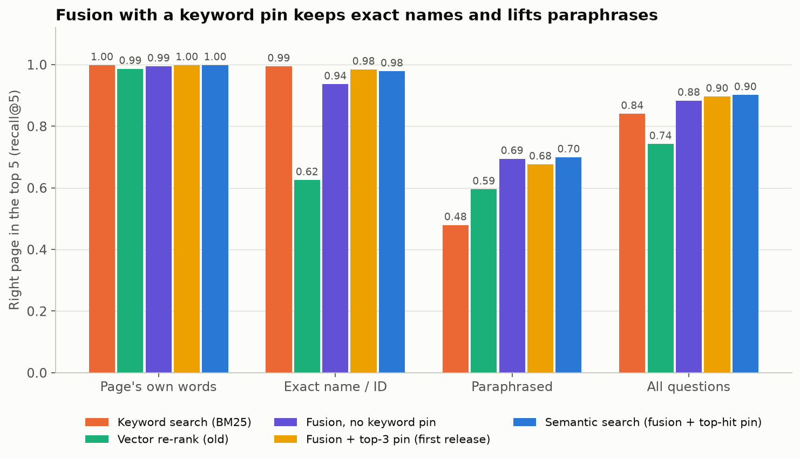
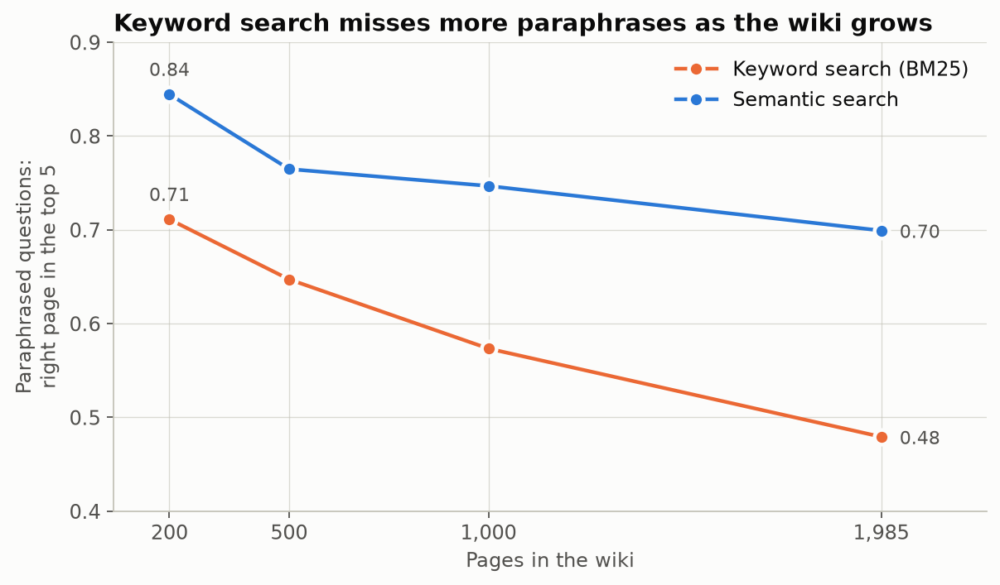
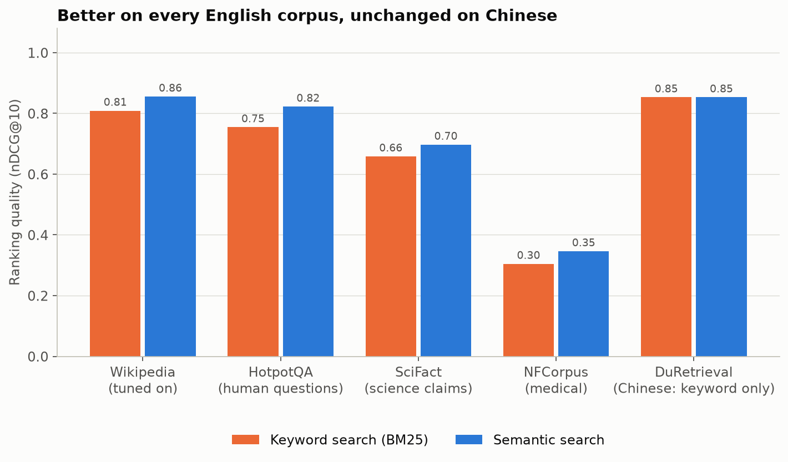
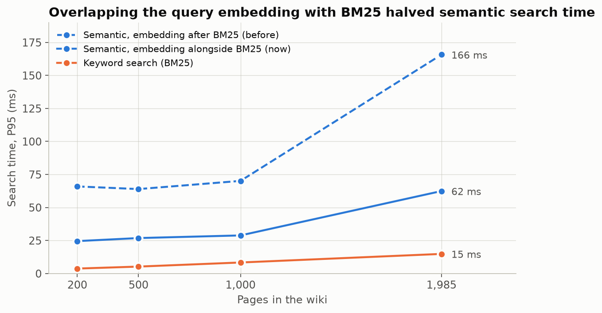

# Retrieval benchmark

Measures how well Synthadoc's search finds the right wiki page, with and
without semantic embeddings ([issue #411](https://github.com/axoviq-ai/synthadoc/issues/411)).
It scores retrieval only — no LLM runs during evaluation — so results are
deterministic, cheap and work offline once the corpora are cached.

## Corpora

| Corpus | Pages | Queries | What it tests |
| --- | --- | --- | --- |
| **wikipedia** | ~2,000 English Wikipedia articles from 24 overlapping computing categories, pinned to fixed revisions, converted to wiki pages (lead + sections, capped at 1,500 words) | 3 LLM-written queries for each of 500 sampled pages | `lexical` (page's own terms), `paraphrase` (same need, no title words or distinctive terms — the case embeddings target), `identifier` (exact name / acronym / number lookup — regressions show here) |
| **hotpot** | ~2,900 Wikipedia intro paragraphs | 300 human-written HotpotQA questions, 2 gold paragraphs each | Questions people actually wrote, as a check on LLM-written queries |
| **scifact** | 5,183 scientific abstracts ([BEIR](https://github.com/beir-cellar/beir) SciFact) | 300 human-written claims, judged by experts | An English domain the fusion settings were not tuned on |
| **nfcorpus** | 3,633 medical documents (BEIR NFCorpus) | 323 human queries, ~38 judged documents each | A second untuned English domain, with many relevant documents per query |
| **duretrieval** | The first 3,000 passages of C-MTEB DuRetrieval (Chinese web Q&A), which hold every judged passage of the first ~440 queries | 300 human queries sampled from those, ~4.7 relevant passages each | Chinese text, for the English-only embedding model |

The wikipedia corpus is also scored at 200, 500 and 1,000 pages as well as in full
(nested seeded subsets), to see whether the gap between keyword and semantic
search grows with wiki size.

## What is committed

Only small files (see [NOTICE.md](NOTICE.md) for licences):

- `data/articles.json` — article titles, revision IDs, source category
- `data/queries.jsonl` — the frozen generated queries
- `data/hotpot.json` — the HotpotQA question IDs used
- `data/external.json` — what was evaluated for scifact, nfcorpus and duretrieval (dataset, split, page and query counts; the sampled DuRetrieval query IDs)
- `data/baseline.json` — the latest recorded scores

Article text, HotpotQA paragraphs, the check corpora and embeddings live in a local cache,
`~/.cache/synthadoc-bench` (override with `SYNTHADOC_BENCH_CACHE` or `--cache`).

## Running

From the repository root:

```bash
python -m benchmarks.retrieval fetch                       # once: download + build the wikis (~30 min)
python -m benchmarks.retrieval evaluate                    # BM25 only
pip install -e ".[vectors]"                                # for embedding configs
python -m benchmarks.retrieval evaluate --configs bm25,hybrid
python -m benchmarks.retrieval evaluate --configs bm25,hybrid --write-baseline
python -m benchmarks.retrieval evaluate --corpora scifact,nfcorpus,duretrieval --configs bm25,hybrid
python -m benchmarks.retrieval charts                      # redraw docs/png/benchmarks/*.png (needs matplotlib)
```

`fetch` also downloads the check corpora from the Hugging Face dataset server,
pacing its requests; NFCorpus takes about 15 minutes.

Configurations:

| Name | Search |
| --- | --- |
| `bm25` | BM25 only — `[search] vector = false`, the default |
| `hybrid` | `[search] vector = true`: BM25 fused with page-embedding search, keyword pin (see [design](../../docs/design.md#semantic-search)) |

The first `hybrid` run embeds every page of the corpus (cached in the
corpus's `embeddings.db`; later runs only embed changed pages).

### How the design was chosen

Measured on the full 1,985-page corpus while designing semantic search
(recall@5, page-level embeddings of each page's first 512 characters):

| Setup | lexical | identifier | paraphrase | all |
| --- | ---: | ---: | ---: | ---: |
| BM25 | 0.998 | 0.994 | 0.479 | 0.840 |
| BM25 top 20 re-sorted by embedding similarity (the former `vector = true`) | 0.986 | 0.625 | 0.595 | 0.742 |
| BM25 + embedding search, reciprocal rank fusion | 0.994 | 0.936 | 0.694 | 0.883 |
| Fusion + keyword pin of BM25's top 3 when its best score ≥ 1.05× its second (first release) | 0.998 | 0.984 | 0.676 | 0.896 |
| **Fusion + keyword pin of BM25's top hit only (shipped)** | 0.998 | 0.978 | **0.699** | **0.901** |
| First release, but one embedding per section instead of per page | 0.998 | 0.986 | 0.613 | 0.878 |



**Why only the top hit is pinned.** At 1.05× the pin fires on 96% of
own-words, 98% of exact-name and 53% of paraphrased questions. When it fires,
BM25's top result is the labelled page 99%, 94% and 45% of the time, but its
second and third results are the labelled page for at most 6%. Pinning all
three cost 10 paraphrased questions to save 3 exact-name ones, and on the
held-out corpora (below) pinning only the top hit is at least as good on every
measure. Pinning the top hit at 1.05× and the top three only at a larger
margin (1.1×–3×) never beat it.

Section embeddings rank better on their own (paraphrase recall@5 0.669 vs
0.616 for the embedding search alone) but fuse worse, because they mostly
find the pages BM25 already finds, and embedding the 14,511 sections took
82 minutes against a few minutes for one embedding per page. Semantic search
therefore embeds each page once (title, tags, first 512 characters).

Metrics, per query type and wiki size: recall@5/10/20 (share of the right
pages in the top k), MRR@10 and nDCG@10 (how high they rank), and P50/P95
search latency.

### Results by wiki size

The gap between keyword and semantic search grows with the wiki: paraphrased
questions found in the top 5 fall from 0.71 to 0.48 with BM25 between 200 and
1,985 pages, and from 0.84 to 0.70 with semantic search.



### Independent checks

The fusion settings were chosen on the wikipedia corpus. The other corpora have
human-written queries and human relevance judgements (nDCG@10; recall@5 understates
NFCorpus, whose queries have ~38 relevant documents each):

| Corpus | `bm25` nDCG@10 | `hybrid` nDCG@10 | `bm25` MRR@10 | `hybrid` MRR@10 |
| --- | ---: | ---: | ---: | ---: |
| hotpot | 0.755 | **0.822** | 0.848 | **0.886** |
| scifact | 0.658 | **0.697** | 0.629 | **0.659** |
| nfcorpus | 0.305 | **0.346** | 0.505 | **0.554** |
| duretrieval (Chinese) | 0.853 | 0.853 | 0.924 | 0.924 |



Semantic search is better on every English corpus, including the two it was
not tuned on. On Chinese, the English-only embedding model made it worse before
CJK handling was added (recall@5 0.751 → 0.645, nDCG@10 0.853 → 0.780): it pulled
unrelated passages into the fused results. Since then, pages whose text is
mostly Chinese, Japanese or Korean are not embedded and a query with CJK
characters is answered by BM25 alone, so `hybrid` scores exactly as `bm25`
there. These results are why new wikis are created with `vector = "auto"`.

What that means for a mixed wiki (from a test wiki with six Chinese and three
English pages):

| Question | Page found | By |
| --- | --- | --- |
| 谁发明了晶体管？ | 晶体管 (Chinese page) | BM25 on the Chinese question |
| 谁发明了第一个编译器？ | Grace Hopper (English page) | BM25 + embeddings on its English translation |
| the woman who found a moth in a machine | Grace Hopper | embeddings (no shared keywords) |
| Who invented the transistor? | not found | English words cannot match Chinese text, and Chinese pages are not embedded |

The query agent translates CJK questions to English for retrieval and searches
the original question too, so pages in either language are found. This
benchmark calls search directly, without that step, so a DuRetrieval query is
always searched in Chinese.

### Latency

P95 search latency, all queries (each query is asked once, so the query
embedding cache never helps here):

| Pages | `bm25` | `hybrid`, embedding after BM25 | `hybrid`, embedding alongside BM25 |
| ---: | ---: | ---: | ---: |
| 200 | 4 ms | 66 ms | 25 ms |
| 500 | 5 ms | 64 ms | 27 ms |
| 1,000 | 8 ms | 70 ms | 29 ms |
| 1,985 | 15 ms | 166 ms | 62 ms |

Embedding the query is most of the extra time (about 20 ms on CPU); comparing
it with every page embedding takes under 2 ms. Starting the query embedding
in a worker thread before BM25 runs overlaps the two, with identical results.


Latency varies by roughly ±10–30 ms between runs on the same machine; the table is the committed baseline.

### Maintainers only

```bash
python -m benchmarks.retrieval select      # re-pin the article list (changes every result)
python -m benchmarks.retrieval generate --provider anthropic --model claude-sonnet-5-5
```

`generate` needs the provider's API key in the environment, resumes if
interrupted, and retries paraphrases that reuse page terms (dropping any that
still do). Re-generating changes the queries, so commit the new
`queries.jsonl` and `baseline.json` together.

## Caveats

- Queries are run the way `QueryAgent` runs them (lowercased, split, top 20)
  but without its LLM question decomposition, so absolute numbers are a lower
  bound for the full query path; comparisons between configurations hold.
- Each generated query has one labelled page. Another page may also answer it,
  which lowers every configuration's score the same way.
- LLM-written paraphrases may suit embedding models better than real user
  wording; the human-written HotpotQA set is the check on that.
- HotpotQA distractor paragraphs were chosen for word overlap with the
  question, which makes that corpus deliberately hard for keyword search.
- The duretrieval corpus is a slice: its pages are the judged passages of
  ~440 queries, so each query's distractors are other queries' answers rather
  than the full 100,000-passage collection.
- Only Chinese was measured among CJK languages; Japanese and Korean pages are
  handled the same way (left to BM25), unmeasured.
